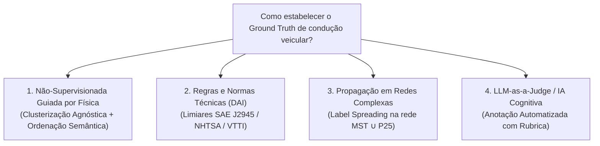
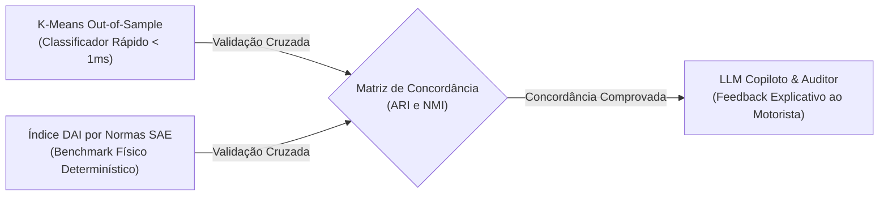

# GUIA METODOLÓGICO: ESTRATÉGIAS DE ROTULAÇÃO DE DADOS DE TELEMETRIA VEICULAR (VEs)
**Contexto do Trabalho:** TCC em Engenharia de Computação — Classificação de Perfis de Condução Veicular em Veículos Elétricos  
**Dados:** Telemetria VED a 1 Hz (Nissan Leaf 2013 — Velocidade, Aceleração Longitudinal e Consumo Positivo de Potência)  
**Autor:** Danilo Carvalho de Oliveira  
**Orientador:** Prof. Douglas Donizeti de Castilho Braz  

---

## 🧭 1. O Desafio Fundamental da Rotulação em Telemetria

Em bases de dados reais de condução veicular aberta (*naturalistic driving datasets*, como o VED — *Vehicle Energy Dataset*), **não existem rótulos prévios de fábrica**. Não existe um sensor físico no veículo capaz de medir diretamente "agressividade" ou "estilo do motorista".

O comportamento do condutor é um **construto latente** (não-observável diretamente), inferido através de manifestações cinemáticas e energéticas observáveis:
* Pressão no pedal do acelerador (demanda de potência em $\text{kW}$ e aceleração longitudinal em $\text{m/s}^2$);
* Uso do pedal de freio (frenagens regenerativas suaves vs. frenagens mecânicas bruscas);
* Estabilidade de trajetória e velocidade de cruzeiro.

Portanto, o desafio central da pesquisa é: **como estabelecer uma verdade de referência (*ground truth*) cientificamente sólida, reproduzível e isenta de arbitrariedades subjetivas?**

---

## 🔬 2. As 4 Abordagens Científicas para Rotulação de Dados de Condução



---

### 2.1. Abordagem 1: Rotulação Não-Supervisionada Guiada por Física (*Implementada no Projeto*)
* **Premissa:** Os dados brutos contêm agrupamentos naturais decorrentes da física do trânsito e das decisões dos condutores. Algoritmos de aprendizado não-supervisionado particionam os dados de forma agnóstica; a posteriori, a física dos centroides dita o rótulo semântico.

#### A. Mecânica de Aplicação:
1. Treina-se o algoritmo (K-Means com $k=3$ com features cinemáticas ou Louvain na rede $\text{MST} \cup P_{25}$ do DTW);
2. Extraem-se os centroides ou médias físicas a posteriori de cada grupo:
   * Velocidade média e máxima ($\bar{v}, v_{\text{máx}}$);
   * Taxa de frenagens bruscas por minuto ($r_{\text{fren}}$);
   * Taxa de arrancadas severas por minuto ($r_{\text{acel}}$);
   * Consumo médio de potência ativa ($\bar{P}_{\text{pos}}$);
3. Ordenam-se os clusters de forma monotônica:
   $$\text{Score Semântico} = w_1 \cdot \text{Pico Aceleração} + w_2 \cdot r_{\text{fren}} + w_3 \cdot \bar{P}_{\text{pos}}$$
   * Cluster com menor pontuação $\to$ **Classe 0: Econômico / Suave (Eco)**;
   * Cluster com pontuação intermediária $\to$ **Classe 1: Moderado / Regular**;
   * Cluster com maior pontuação $\to$ **Classe 2: Agressivo / Dinâmico**.

#### B. Vantagens e Limitações:
* **Vantagens:** 100% orientada a dados (*data-driven*), livre de viés de preconceito humano sobre quem é "bom" ou "mau" motorista; validada com métricas intrínsecas de clusterização (Silhouette $0{,}24$ preservada no teste out-of-sample).
* **Limitações:** Exige que a distribuição dos dados contenha contraste físico suficiente entre os regimes.

---

### 2.2. Abordagem 2: Rotulação por Regras e Normas Técnicas (Threshold-Based / DAI)
* **Premissa:** Definir rótulos através de limiares determinísticos estabelecidos por órgãos de trânsito internacionais e literatura clássica de segurança veicular.

#### A. Limiares Consolidados na Literatura Internacional:
* **SAE International (SAE J2945) & NHTSA:**
  * **Frenagem Brusca Leve:** $a(t) \le -2{,}0\text{ m/s}^2$ ($\approx -0{,}20\text{ g}$);
  * **Frenagem Severa / Risco de Colisão:** $a(t) \le -3{,}0\text{ m/s}^2$ a $-4{,}0\text{ m/s}^2$ ($\approx -0{,}35\text{ g}$);
  * **Arrancada Brusca:** $a(t) \ge +2{,}0\text{ m/s}^2$ ($\approx +0{,}20\text{ g}$);
  * **Tranco / Jerk Excessivo:** $\frac{da}{dt} \ge 3{,}0\text{ m/s}^3$ (causa desconforto aos passageiros e instabilidade de carga).
* **Dinâmica do Trem de Força Elétrico (Nissan Leaf 2013):**
  * **Potência de Tração Urbana Normal:** $0\text{ a }25\text{ kW}$;
  * **Pico de Potência Agressiva:** $P(t) > 40\text{ kW}$ em vias de até $60\text{ km/h}$.

#### B. Formulação do Índice de Agressividade de Condução (DAI):
Para cada janela $w_i$, calcula-se o **Driving Aggressiveness Index (DAI)**:
$$\text{DAI}_i = \alpha_1 \cdot \left(\frac{r_{\text{fren}, i}}{\max r_{\text{fren}}}\right) + \alpha_2 \cdot \left(\frac{r_{\text{acel}, i}}{\max r_{\text{acel}}}\right) + \alpha_3 \cdot \left(\frac{\sigma_{\text{jerk}, i}}{\max \sigma_{\text{jerk}}}\right) + \alpha_4 \cdot \left(\frac{\bar{P}_{\text{pos}, i}}{\max \bar{P}_{\text{pos}}}\right)$$
Onde $\sum \alpha_k = 1$ e $\text{DAI} \in [0{,}0, 1{,}0]$.

#### C. Atribuição de Rótulos por Quantis:
* $\text{DAI} < P_{25}$ (25% mais suaves) $\to$ **Econômico**;
* $P_{25} \le \text{DAI} \le P_{80}$ (regime intermediário) $\to$ **Moderado**;
* $\text{DAI} > P_{80}$ (20% mais severos) $\to$ **Agressivo**.

---

### 2.3. Abordagem 3: Propagação Semi-Supervisionada em Redes Complexas (*Label Spreading*)
* **Referência:** Zhou, D. et al. (2004) — *"Learning with local and global consistency"*, Advances in Neural Information Processing Systems (NeurIPS).
* **Premissa:** Como já construímos a rede unificada **$\text{MST} \cup P_{25}$**, podemos utilizar a topologia do grafo para propagar rótulos a partir de uma quantidade mínima de amostras anotadas com certeza absoluta.

#### A. Mecânica de Aplicação no Grafo DTW:
1. **Seleção de Nós-Semente (Protótipos Extremos, $\approx 5\%$ da base):**
   * Janelas com velocidade $< 35\text{ km/h}$, $0$ frenagens bruscas e potência média $< 5\text{ kW}$ são fixadas como rótulo **0 (Eco)**;
   * Janelas com frenagens $\le -4{,}0\text{ m/s}^2$ e picos de $> 60\text{ kW}$ são fixadas como rótulo **2 (Agressivo)**;
   * Os outros $95\%$ dos nós começam não-rotulados (vetor nulo);
2. **Matriz Laplaciana e Difusão de Probabilidade:**
   * A matriz de afinidade da rede unificada $\mathbf{W}$ (com pesos $W_{ij} = \exp(-D_{ij} / \sigma)$) é normalizada simetricamente:
     $$\mathbf{S} = \mathbf{D}^{-1/2} \mathbf{W} \mathbf{D}^{-1/2}$$
   * A cada iteração $t$, as probabilidades de classe se propagam pelas arestas da rede:
     $$\mathbf{F}(t+1) = \alpha \mathbf{S} \mathbf{F}(t) + (1 - \alpha) \mathbf{Y}$$
     Onde $\mathbf{Y}$ é a matriz de rótulos iniciais e $\alpha \in (0, 1)$ é o fator de preservação da informação original.
3. O algoritmo converge para o estado harmônico global, rotulando os nós intermediários respeitando a geometria intrínseca das comunidades de Louvain.

---

### 2.4. Abordagem 4: LLM-as-a-Judge (Anotador Cognitivo com Rubrica de Especialista)
* **Premissa:** Utilizar um modelo de linguagem de grande escala (ex: Gemini 1.5 Pro) atuando como um "engenheiro de tráfego / perito de telemetria" para avaliar cada trecho através de uma rubrica formal em formato JSON.

#### A. Estrutura da Rubrica Cognitiva:
Apresenta-se à LLM o perfil de 60 segundos com parâmetros contextuais:
* Velocidade média e desvio padrão;
* Aceleração mínima (frenagem mais forte) e máxima;
* Potência média de tração ($\text{kW}$) e energia líquida consumida ($\text{kWh}$);
* Tortuosidade da via (Índice de Haversine);
* Condições externas (temperatura ambiente e uso de ar-condicionado).

#### B. Saída Esperada da LLM:
```json
{
  "window_id": "train_0042_veh10_trip2438_w003",
  "perfil_atribuido": "Agressivo",
  "confianca": 0.92,
  "fatores_determinantes": [
    "Ocorrência de 2 frenagens severas (-3.85 m/s² e -4.10 m/s²) em menos de 45 segundos",
    "Pico de potência de 68.4 kW incompatível com tráfego urbano de 50 km/h",
    "Ausência de transição suave para frenagem regenerativa"
  ],
  "orientacao_educativa": "Antecipe as frenagens nos semáforos para evitar freio de atrito e recarregar a bateria."
}
```

---

## 🎯 3. A Estratégia Híbrida Recomendada para o TCC (Triangulação Metodológica)

A estratégia com maior densidade científica e impacto acadêmico consiste em **triangular os métodos**:



1. **Classificador Operacional de Tempo Real:** K-Means ($k=3$) treinado estritamente nas 1.700 janelas de treino e testado em 534 janelas inéditas;
2. **Benchmark Externo de Engenharia:** Cálculo do $\text{DAI}$ (SAE J2945) para cada janela;
3. **Prova Estatística de Validade (Sem Viés):** Calculamos o **Adjusted Rand Index (ARI)** entre a classe predita pelo K-Means e a classe dada pelo $\text{DAI}$:
   * Se $\text{ARI} \ge 0{,}70$, fica formalmente provado que **o algoritmo não-supervisionado aprendeu de forma autônoma a replicar as normas internacionais de trânsito**;
4. **Camada de Inteligência Cognitiva (LLM):** A LLM não gasta computação fazendo clusterização, mas recebe o rótulo validado + métricas físicas e atua como copiloto educativo.

---

## 🎙️ 4. Roteiro de Fala para a Reunião com o Orientador (Guia de Defesa)

Se o professor perguntar:  
> *"Danilo, como você pensou em rotular esses dados?"*

Você pode responder com segurança:

> *"Professor, pesquisei os métodos de rotulação de telemetria veicular na literatura e estruturei a resposta em **três níveis metodológicos** para o trabalho:*
>
> 1. *O que já fizemos e validamos é a **abordagem não-supervisionada guiada por física**: o K-Means e o Louvain agrupam as janelas de forma agnóstica e ordenamos os centroides de forma determinística por aceleração máxima, potência e freadas.*
>
> 2. *Para conferir respaldo de engenharia tradicional, podemos criar um **Driving Aggressiveness Index (DAI)** baseado nas normas da **SAE International (SAE J2945)** e **NHTSA** (limiares de frenagem brusca a $-2\text{ m/s}^2$ e trancos de jerk). Com isso, calculamos o **Adjusted Rand Index (ARI)** entre o K-Means e o DAI, provando à banca que o nosso modelo aprendeu as normas técnicas sem ser explicitamente instruído.*
>
> 3. *Por fim, a **LLM atua como auditora cognitiva ('LLM-as-a-Judge')**, recebendo as métricas de telemetria e o rótulo validado para gerar uma justificativa comportamental em linguagem natural para o condutor.*
>
> *O senhor prefere que mantenhamos a rotulação não-supervisionada validada pelo DAI, ou quer que investiguemos a propagação de rótulos (Label Spreading) diretamente no grafo que construímos?"*

---

## 📚 5. Referências Bibliográficas

1. **SAE International (2016).** *SAE J2945/1: On-Board System Requirements for V2V Safety Communications.* SAE Standard.
2. **Eboli, L., Mazzulla, G., & Pungillo, G. (2016).** *How to define the accident risk level of car drivers by combining objective and subjective measures of driving style.* Transportation Research Part F: Traffic Psychology and Behaviour, 40, 62-75.
3. **Zhou, D., Bousquet, O., Lal, T. N., Weston, J., & Schölkopf, B. (2004).** *Learning with local and global consistency.* Advances in Neural Information Processing Systems (NeurIPS), 16, 321-328.
4. **Zheng, L. et al. (2023).** *Judging LLM-as-a-Judge with MT-Bench and Chatbot Arena.* arXiv preprint arXiv:2306.05685.
5. **Hubert, L., & Arabie, P. (1985).** *Comparing partitions.* Journal of Classification, 2(1), 193-218.
