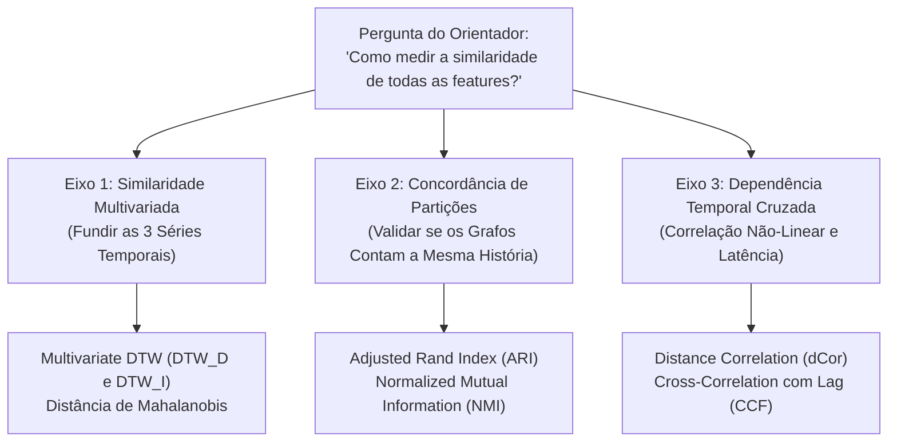

# GUIA DE ESTUDO: MÉTRICAS DE SIMILARIDADE ENTRE FEATURES E SÉRIES TEMPORAIS MULTIVARIADAS
**Contexto do Trabalho:** TCC em Engenharia de Computação — Classificação de Perfis de Condução Veicular em Veículos Elétricos  
**Dados:** Telemetria VED a 1 Hz (Nissan Leaf 2013 — Velocidade, Aceleração Longitudinal e Consumo Positivo de Potência)  
**Autor:** Danilo Carvalho de Oliveira  
**Orientador:** Prof. Douglas Donizeti de Castilho Braz  

---

## 🧭 1. Visão Geral: As 3 Interpretações da Pergunta do Orientador

Quando o orientador solicita pesquisar **"métricas para medir a similaridade de todas as features"**, na literatura científica e acadêmica existem **três problemas distintos e complementares**. Demonstrar o domínio dessas três vertentes confere solidez metodológica incontestável perante a banca.

---

## 🔬 2. EIXO 1: Similaridade Multivariada entre Janelas de Condução
> **Objetivo:** Em vez de analisar o DTW isoladamente em velocidade ($1.700 \times 1.700$), aceleração ou potência, como computar uma **única matriz de distância global** integrando todas as grandezas em um espaço comum?

---

### 2.1. Multivariate DTW Dependente ($DTW_D$) — *Padrão Ouro na Literatura*
* **Referência:** Shokoohi-Yekta et al. (2017) — *"Generalizing DTW to the multi-dimensional case"*, Data Mining and Knowledge Discovery.

#### A. Formulação Matemática:
Em cada instante $t \in [1, T]$, o ponto da telemetria é um vetor multidimensional padronizado:
$$\mathbf{x}(t) = \begin{bmatrix} z_v(t) \\ z_a(t) \\ z_P(t) \end{bmatrix} \in \mathbb{R}^3$$

Onde cada grandeza deve ser obrigatoriamente padronizada via Z-Score ($z = \frac{x - \mu}{\sigma}$) para eliminar distorções de unidades ($\text{km/h}$ vs. $\text{m/s}^2$ vs. $\text{kW}$).

A distância local entre o segundo $t_1$ da Janela $A$ e o segundo $t_2$ da Janela $B$ é calculada pela **Norma Euclidiana Multidimensional**:
$$d_{\text{local}}(t_1, t_2) = \|\mathbf{x}_A(t_1) - \mathbf{x}_B(t_2)\|_2 = \sqrt{\left(z_{v,A}(t_1) - z_{v,B}(t_2)\right)^2 + \left(z_{a,A}(t_1) - z_{a,B}(t_2)\right)^2 + \left(z_{P,A}(t_1) - z_{P,B}(t_2)\right)^2}$$

A matriz acumulada de programação dinâmica opera normalmente:
$$D(t_1, t_2) = d_{\text{local}}(t_1, t_2) + \min\left(D(t_1-1, t_2), D(t_1, t_2-1), D(t_1-1, t_2-1)\right)$$

#### B. Justificativa Física no Carro Elétrico:
* Quando o motorista pisa no acelerador, a aceleração $a(t)$ cresce, a potência elétrica $P(t)$ sobe de forma concomitante e a velocidade $v(t)$ começa a se elevar.
* O $DTW_D$ força um **único caminho de deformação temporal (*warping path*)** compartilhado por todas as variáveis. Isso garante que o algoritmo não alinhe a aceleração de um trecho com a potência de outro em tempos desconexos.

---

### 2.2. Multivariate DTW Independente ($DTW_I$)
* **Como funciona:** O DTW é calculado separadamente para cada variável (exatamente o que já temos implementado: $D_v$, $D_a$, $D_P$) e a matriz mestre combinada é obtida por uma soma ponderada normalizada pelas médias:
  $$D_{\text{global}}(A, B) = w_v \cdot \frac{D_v(A, B)}{\mu(D_v)} + w_a \cdot \frac{D_a(A, B)}{\mu(D_a)} + w_P \cdot \frac{D_P(A, B)}{\mu(D_P)}$$
  Com $\sum w_i = 1$ (por exemplo, pesos iguais $w_v = w_a = w_P = \frac{1}{3}$).
* **Quando usar:** Quando se deseja flexibilidade para calibrar o peso relativo de cada variável (ex: dar mais peso à potência para focar em eco-driving).

---

### 2.3. Distância de Mahalanobis Multivariada
* **Referência:** Mahalanobis, P. C. (1936) — *"On the generalized distance in statistics"*.

#### A. O Problema Físico da Colinearidade:
Na dinâmica veicular, potência, velocidade e aceleração não são variáveis independentes. Pela física clássica:
$$P(t) \approx F_{\text{tração}} \cdot v(t) = \left(m \cdot a(t) + \frac{1}{2}\rho C_d A v(t)^2 + m g f_r\right) \cdot v(t)$$
Se usarmos a distância Euclidiana simples, o algoritmo dá um **peso desproporcional à potência**, porque ela já incorpora o produto de velocidade por aceleração.

#### B. Solução de Mahalanobis:
A distância entre duas janelas no espaço de features agregadas desconta a **matriz de covariância ($\mathbf{\Sigma}$)**:
$$D_M(\mathbf{x}, \mathbf{y}) = \sqrt{(\mathbf{x} - \mathbf{y})^T \mathbf{\Sigma}^{-1} (\mathbf{x} - \mathbf{y})}$$
* Se duas features são correlacionadas em $80\%$, a métrica de Mahalanobis remove a redundância mútua, medindo apenas a variação genuína e ortogonal.

---

## 🧩 3. EIXO 2: Concordância entre as Partições das Features (Cluster Agreement)
> **Objetivo:** Como já temos as redes complexas e os clusters de Louvain executados para Velocidade, Aceleração e Potência, como medir o grau de concordância entre os resultados obtidos por cada grandeza?

---

### 3.1. Adjusted Rand Index (ARI) — *Métrica Principal de Concordância*
* **Referência:** Hubert & Arabie (1985) — *"Comparing partitions"*, Journal of Classification.
* **Faixa de Valores:** $[-1{,}0 \text{ a } +1{,}0]$.
  * $+1{,}0$: Concordância perfeita entre as partições;
  * $0{,}0$: Concordância esperada puramente por sorte/acaso;
  * $< 0{,}0$: Concordância inferior ao acaso (divergência sistemática).

#### A. Mecânica de Cálculo:
Avalia todos os pares de janelas de treino $\binom{N}{2} = \frac{1.700 \times 1.699}{2} = 1.444.150$ pares:
* $a$: Pares agrupados juntos na partição da Velocidade E na partição da Potência;
* $b$: Pares agrupados juntos na Velocidade, mas separados na Potência;
* $c$: Pares separados na Velocidade, mas agrupados juntos na Potência;
* $d$: Pares separados em ambas as partições.

$$\text{Rand Index (RI)} = \frac{a + d}{a + b + c + d}$$
$$\text{ARI} = \frac{\text{RI} - \mathbb{E}[\text{RI}]}{\max(\text{RI}) - \mathbb{E}[\text{RI}]}$$

---

### 3.2. Normalized Mutual Information (NMI)
* **Referência:** Danon et al. (2005) — *"Comparing community structure identification"*, J. Stat. Mech.
* **Faixa de Valores:** $[0{,}0 \text{ a } 1{,}0]$.
  * $1{,}0$: Partições idênticas (informação compartilhada máxima);
  * $0{,}0$: Nenhuma correlação estatística entre os clusters.

#### A. Formulação por Entropia de Shannon:
Seja $U$ a partição em comunidades obtida pela Velocidade e $V$ a obtida pela Potência:
$$\text{NMI}(U, V) = \frac{2 \cdot I(U; V)}{H(U) + H(V)}$$
Onde $I(U; V)$ é a Informação Mútua e $H(U)$ é a entropia da partição:
$$I(U; V) = \sum_{u \in U} \sum_{v \in V} P(u, v) \log \left(\frac{P(u, v)}{P(u) P(v)}\right)$$

---

### 3.3. Coeficiente de Similaridade de Jaccard sobre as Arestas da MST
* **Objetivo:** Medir se o esqueleto físico da Árvore Geradora Mínima conecta as mesmas janelas independentemente da grandeza analisada.
$$J(E_{\text{vel}}, E_{\text{pot}}) = \frac{|E_{\text{vel}} \cap E_{\text{pot}}|}{|E_{\text{vel}} \cup E_{\text{pot}}|}$$
* Como cada MST possui exatamente $1.699$ arestas, essa métrica quantifica a sobreposição direta de topologia entre as dimensões cinemática e energética.

---

## 📈 4. EIXO 3: Dependência Temporal Cruzada e Correlação entre Features
> **Objetivo:** Medir o quanto as séries temporais de duas grandezas caminham juntas ao longo do tempo dentro de uma viagem.

---

### 4.1. Distance Correlation ($d\text{Cor}$)
* **Referência:** Székely, Rizzo & Bakirov (2007) — *"Measuring and testing dependence by correlation of distances"*, Annals of Statistics.
* **Faixa de Valores:** $[0{,}0 \text{ a } 1{,}0]$.
* **Propriedade Fundamental:**
  $$d\text{Cor}(X, Y) = 0 \iff X \text{ e } Y \text{ são estritamente independentes}$$
* Diferentemente do Pearson (que só mede retas lineares) e do Spearman (que só mede monotonia), a $d\text{Cor}$ detecta relações parabólicas, sinusoidais ou não-lineares arbitrárias entre aceleração e consumo.

---

### 4.2. Cross-Correlation com Atraso Temporal ($\text{CCF}(\tau)$)
* **Formula:**
  $$\text{CCF}(\tau) = \frac{\sum_{t} \left(a(t) - \bar{a}\right) \left(P(t + \tau) - \bar{P}\right)}{\sqrt{\sum_t (a(t) - \bar{a})^2 \sum_t (P(t) - \bar{P})^2}}$$
* **Aplicação em Veículos Elétricos:** 
  Permite identificar a **latência eletromecânica ($\tau$)**: quando o condutor afunda o pé no acelerador em $t$, em quantos milissegundos o inversor atinge o pico de potência $P(t+\tau)$.

---

## 📊 5. Matriz Comparativa Resumida das Métricas

| Eixo Metodológico | Métrica | Escopo / Entrada | Faixa de Valores | Complexidade Computacional | Principal Vantagem no TCC |
| :--- | :--- | :--- | :---: | :---: | :--- |
| **Similaridade Multivariada** | **Multivariate DTW Dependente ($DTW_D$)** | Séries temporais 1 Hz $[v(t), a(t), P(t)]^T$ | $[0, +\infty)$ | $\mathcal{O}(N^2 \cdot T^2)$ | Alinha todas as variáveis em um único caminho ótimo síncrono. |
| **Similaridade Multivariada** | **DTW Independente Ponderado ($DTW_I$)** | Matrizes DTW univariadas já calculadas | $[0, +\infty)$ | $\mathcal{O}(N^2)$ (imediato) | Reaproveita 100% das matrizes calculadas, permitindo ponderar pesos. |
| **Similaridade Multivariada** | **Distância de Mahalanobis** | Vetores tabulares de features agregadas | $[0, +\infty)$ | $\mathcal{O}(D^3 + N^2 \cdot D)$ | Elimina a redundância da correlação física entre velocidade e potência. |
| **Concordância de Partições** | **Adjusted Rand Index (ARI)** | Rótulos das comunidades de Louvain | $[-1, +1]$ | $\mathcal{O}(N)$ | Comprova se o perfil agressivo na velocidade é agressivo na potência. |
| **Concordância de Partições** | **Normalized Mutual Info (NMI)** | Rótulos das comunidades de Louvain | $[0, 1]$ | $\mathcal{O}(N)$ | Métrica padrão de teoria da informação e redes complexas. |
| **Dependência Temporal** | **Distance Correlation ($d\text{Cor}$)** | Séries temporais pareadas ponto a ponto | $[0, 1]$ | $\mathcal{O}(T^2)$ | Mede relações não-lineares reais entre o acelerador e a bateria. |

---

## 🎙️ 6. Roteiro de Fala para a Reunião com o Orientador (Guia de Defesa)

Se o professor perguntar:  
> *"Danilo, o que você levantou sobre métricas para medir a similaridade de todas as features?"*

Você pode responder com a seguinte estrutura:

> *"Professor, estruturei a pesquisa em **dois caminhos complementares** para o nosso TCC:*
>
> 1. *Se o objetivo for **medir a concordância entre os resultados que já geramos**, a literatura recomenda o **Adjusted Rand Index (ARI)** e a **Normalized Mutual Information (NMI)**. Com elas, comparamos matematicamente as comunidades encontradas na velocidade, na aceleração e no consumo positivo, provando se os motoristas mantêm coerência comportamental entre as três dimensões físicas.*
>
> 2. *Se o objetivo for **gerar uma única matriz de distância que funde as 3 grandezas**, a literatura aponta o **Multivariate DTW Dependente ($DTW_D$)**, onde o alinhamento é feito sobre o vetor padronizado $[\text{velocidade}, \text{aceleração}, \text{potência}]^T$, ou a **Distância de Mahalanobis**, que é fundamental no nosso caso porque ela desconta a covariância física natural entre velocidade e potência.*
>
> *Qual dessas abordagens o senhor acha que agrega mais valor à monografia: a validação de concordância cruzada (ARI/NMI) ou a fusão multivariada ($DTW_D$)?"*

---

## 📚 7. Referências Bibliográficas Selecionadas

1. **Shokoohi-Yekta, M. et al. (2017).** *Generalizing DTW to the multi-dimensional case.* Data Mining and Knowledge Discovery, 31(1), 1-31.
2. **Hubert, L., & Arabie, P. (1985).** *Comparing partitions.* Journal of Classification, 2(1), 193-218.
3. **Danon, L., Diaz-Guilera, A., Duch, J., & Arenas, A. (2005).** *Comparing community structure identification.* Journal of Statistical Mechanics: Theory and Experiment, 2005(09), P09008.
4. **Mahalanobis, P. C. (1936).** *On the generalized distance in statistics.* Proceedings of the National Institute of Sciences of India, 2(1), 49-55.
5. **Székely, G. J., Rizzo, M. L., & Bakirov, N. K. (2007).** *Measuring and testing dependence by correlation of distances.* The Annals of Statistics, 35(6), 2769-2794.
