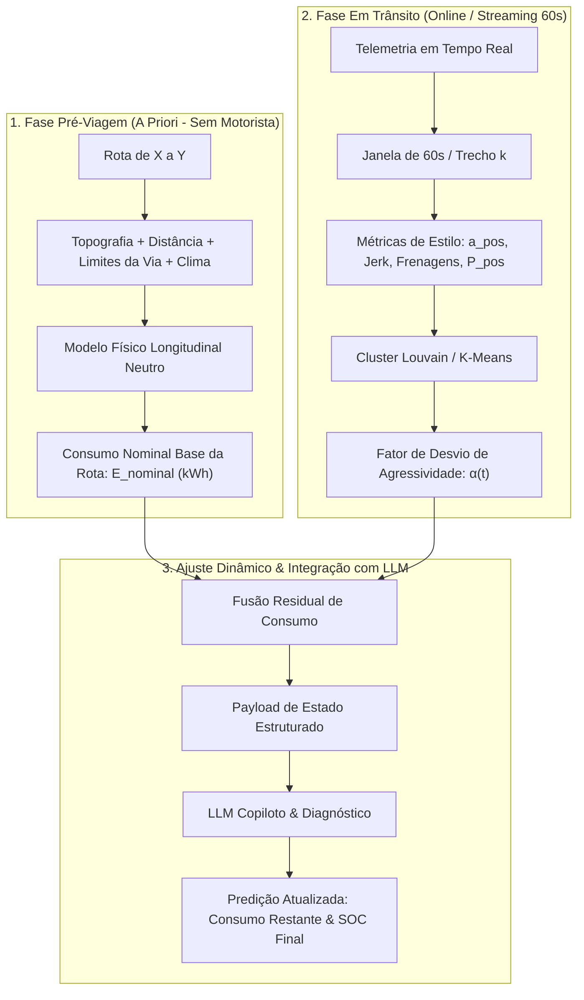
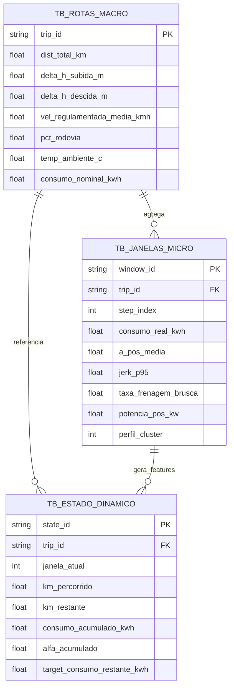
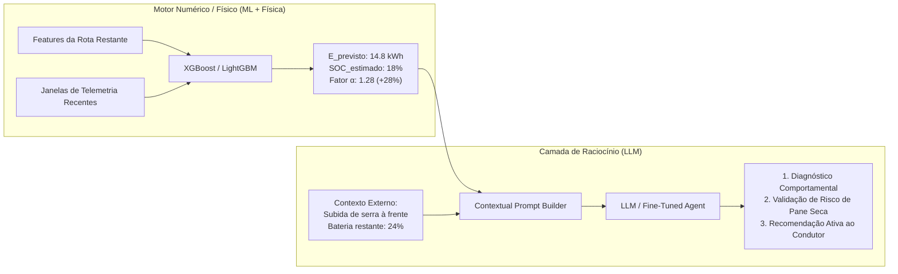

# MODELAGEM DA BASE DE DADOS PARA PREDIÇÃO DE CONSUMO DE VEÍCULOS ELÉTRICOS
## Arquitetura em Duas Camadas: Baseline de Rota (A Priori) & Adaptação Dinâmica por Telemetria (In-Trip)

---

### Sumário
1. [Visão Geral e Contexto da Pesquisa](#1-visão-geral-e-contexto-da-pesquisa)
2. [O Paradigma de Predição em Duas Camadas (Two-Tier Architecture)](#2-o-paradigma-de-predição-em-duas-camadas-two-tier-architecture)
3. [Modelagem Relacional da Base de Dados (Esquema em 3 Níveis)](#3-modelagem-relacional-da-base-de-dados-esquema-em-3-níveis)
   - [3.1 Tabela Macro: `tb_rotas_macro` (Nível Trajeto X a Y)](#31-tabela-macro-tb_rotas_macro-nível-trajeto-x-a-y)
   - [3.2 Tabela Micro: `tb_janelas_micro` (Série Temporal de 60s)](#32-tabela-micro-tb_janelas_micro-série-temporal-de-60s)
   - [3.3 Tabela Mestre de Treinamento: `tb_estado_dinamico` (Transição e Resíduo)](#33-tabela-mestre-de-treinamento-tb_estado_dinamico-transição-e-resíduo)
4. [Formulação Matemática e Física do Consumo](#4-formulação-matemática-e-física-do-consumo)
   - [4.1 Modelo Físico Longitudinal Neutro (Consumo Nominal da Rota)](#41-modelo-físico-longitudinal-neutro-consumo-nominal-da-rota)
   - [4.2 Fator de Desvio Comportamental ($\alpha$) e Consumo Residual ($\Delta E$)](#42-fator-de-desvio-comportamental-alpha-e-consumo-residual-delta-e)
5. [O Papel da LLM: Arquitetura Híbrida Neuro-Simbólica](#5-o-papel-da-llm-arquitetura-híbrida-neuro-simbólica)
   - [5.1 Por que não cálculo numérico puro na LLM?](#51-por-que-não-cálculo-numérico-puro-na-llm)
   - [5.2 A LLM como Copiloto de Raciocínio Contextual e Diagnóstico](#52-a-llm-como-copiloto-de-raciocínio-contextual-e-diagnóstico)
   - [5.3 Payload JSON Estruturado de Entrada da LLM](#53-payload-json-estruturado-de-entrada-da-llm)
6. [Guia de Resposta ao Orientador (Prof. Douglas)](#6-guia-de-resposta-ao-orientador-prof-douglas)
   - [6.1 Resumo Executivo (Pitch de 1 minuto)](#61-resumo-executivo-pitch-de-1-minuto)
   - [6.2 Respostas Prontas para as Perguntas Críticas](#62-respostas-prontas-para-as-perguntas-críticas)
7. [Plano de Implementação Prática com a Base VED](#7-plano-de-implementação-prática-com-a-base-ved)

---

### 1. Visão Geral e Contexto da Pesquisa

O objetivo central deste trabalho de conclusão de curso (TCC) é prever o **consumo energético de um Veículo Elétrico (Nissan Leaf 2013, 24 kWh)** ao longo de uma rota planejada de um Ponto $X$ a um Ponto $Y$. 

Diferente de abordagens ingênuas que exigem saber antecipadamente quem é o motorista, a pesquisa adota o **estado da arte da indústria automotiva elétrica** (empregado por fabricantes como Tesla, Polestar e Porsche):
1. **Fase A Priori (Pré-viagem):** Estima-se o consumo nominal da rota considerando unicamente as restrições da via, topografia, tráfego e clima, assumindo um motorista hipotético neutro.
2. **Fase In-Trip (Online / Streaming):** Conforme o veículo avança (em janelas de telemetria de 60 segundos), o sistema monitora se o motorista real é agressivo, moderado ou calmo, recalculando dinamicamente a autonomia restante e o estado de carga da bateria (State of Charge - SOC) no destino final.

Para viabilizar essa abordagem, a base de dados precisa ser modelada para desacoplar as **variáveis do ambiente/rota** das **variáveis de estilo de condução**.

---

### 2. O Paradigma de Predição em Duas Camadas (Two-Tier Architecture)



---

### 3. Modelagem Relacional da Base de Dados (Esquema em 3 Níveis)

A modelagem de dados adota um esquema estrela (*Star Schema*) adaptado para séries temporais veiculares.



---

#### 3.1 Tabela Macro: `tb_rotas_macro` (Nível Trajeto X a Y)
Representa as características puras do trajeto de $X$ a $Y$, **independentes de quem está dirigindo**.

| Coluna | Tipo | Unidade | Descrição |
| :--- | :--- | :--- | :--- |
| `trip_id` | `VARCHAR(64)` | - | Chave primária que identifica a viagem completa. |
| `dist_total_km` | `FLOAT` | $\text{km}$ | Distância total do trajeto de $X$ a $Y$. |
| `delta_h_subida_m` | `FLOAT` | $\text{m}$ | Ganho de elevação positivo acumulado ($\sum \Delta h^+$). |
| `delta_h_descida_m` | `FLOAT` | $\text{m}$ | Perda de elevação negativa acumulada ($\sum \Delta h^-$). |
| `slope_medio_pct` | `FLOAT` | $\%$ | Inclinação média da rota. |
| `vel_regulamentada_kmh` | `FLOAT` | $\text{km/h}$ | Velocidade limite média ponderada pelos trechos da via. |
| `pct_urbano` | `FLOAT` | $\%$ | Percentual do trajeto em malha urbana ($< 60\text{ km/h}$). |
| `pct_rodovia` | `FLOAT` | $\%$ | Percentual do trajeto em rodovia ($> 80\text{ km/h}$). |
| `temp_ambiente_c` | `FLOAT` | $^{\circ}\text{C}$ | Temperatura externa (afeta densidade do ar e uso de ar-condicionado). |
| `consumo_nominal_kwh` | `FLOAT` | $\text{kWh}$ | **Target A Priori:** Consumo teórico previsto pelo modelo físico neutro. |

---

#### 3.2 Tabela Micro: `tb_janelas_micro` (Série Temporal de 60s)
Corresponde às janelas já extraídas do VED (1.700 janelas de treino e 534 de teste), vinculadas sequencialmente à viagem:

| Coluna | Tipo | Unidade | Descrição |
| :--- | :--- | :--- | :--- |
| `window_id` | `VARCHAR(64)` | - | Chave primária da janela (ex: `trip_042_w007`). |
| `trip_id` | `VARCHAR(64)` | - | Chave estrangeira ligando à rota macro. |
| `step_index` | `INT` | - | Ordem cronológica da janela na viagem ($1, 2, \dots, N$). |
| `duracao_s` | `FLOAT` | $\text{s}$ | Duração temporal da janela ($60.0\text{ s}$). |
| `distancia_km` | `FLOAT` | $\text{km}$ | Distância percorrida na janela. |
| `consumo_real_kwh` | `FLOAT` | $\text{kWh}$ | Energia líquida real medida pela bateria na janela. |
| `a_pos_media` | `FLOAT` | $\text{m/s}^2$ | Aceleração positiva média (intensidade da aceleração). |
| `a_pos_p95` | `FLOAT` | $\text{m/s}^2$ | Percentil 95 da aceleração (picos de agressividade). |
| `jerk_rms` | `FLOAT` | $\text{m/s}^3$ | Variação rápida da aceleração (brusquidão na condução). |
| `taxa_frenagens_bruscas` | `FLOAT` | $\text{adimensional}$ | Fração de tempo com desaceleração $< -2.0\text{ m/s}^2$. |
| `potencia_pos_media_kw` | `FLOAT` | $\text{kW}$ | Demanda de potência positiva média no motor. |
| `taxa_regeneracao_pct` | `FLOAT` | $\%$ | Percentual de energia recuperada nas frenagens. |
| `perfil_cluster` | `INT` | - | Rótulo do perfil ($0=\text{Calmo}$, $1=\text{Moderado}$, $2=\text{Agressivo}$). |

---

#### 3.3 Tabela Mestre de Treinamento: `tb_estado_dinamico` (Transição e Resíduo)
Esta é a tabela fundamental para treinar o algoritmo de aprendizado de máquina e fornecer o contexto para a LLM. Cada linha representa um **corte no tempo ($t$)** durante uma viagem:

| Coluna | Tipo | Descrição |
| :--- | :--- | :--- |
| `state_id` | `VARCHAR(64)` | Identificador do snapshot de viagem. |
| `trip_id` | `VARCHAR(64)` | Identificador da viagem. |
| `janela_atual` | `INT` | Índice da janela em que o veículo se encontra ($t$). |
| `km_percorrido` | `FLOAT` | Quilometragem já percorrida do início até $t$. |
| `km_restante` | `FLOAT` | Quilometragem faltante de $t$ até o destino $Y$. |
| `consumo_real_acumulado_kwh` | `FLOAT` | Total de energia consumida até o instante $t$. |
| `consumo_nominal_restante_kwh` | `FLOAT` | Consumo que a rota teórica previa para o trecho restante. |
| `alfa_acumulado` | `FLOAT` | Fator de desvio do motorista medido até $t$: $\alpha(t) = \frac{\sum E_{\text{real}}(t)}{\sum E_{\text{nominal}}(t)}$. |
| `perfil_recente_predominante` | `INT` | Perfil modal das últimas 3 janelas ($180\text{ s}$). |
| **`target_consumo_restante_kwh`** | `FLOAT` | **VARIÁVEL ALVO ($\hat{Y}$):** O consumo real medido de $t$ até o final da viagem. |

---

### 4. Formulação Matemática e Física do Consumo

#### 4.1 Modelo Físico Longitudinal Neutro (Consumo Nominal da Rota)
Para obter a estimativa *a priori* sem conhecer o motorista, aplicam-se as equações clássicas da dinâmica veicular longitudinal sobre a rota:

$$P_{\text{tracao}}(t) = \left( F_{\text{acel}} + F_{\text{aero}} + F_{\text{rol}} + F_{\text{grav}} \right) \cdot v(t)$$

Onde cada força resistente é calculada por:
1. **Força de Aceleração Neutra:**
   $$F_{\text{acel}} = m \cdot a_{\text{nominal}}$$
   *(Assume-se aceleração suave e controlada, $a_{\text{nominal}} \le 0.6\text{ m/s}^2$)*
2. **Resistência Aerodinâmica:**
   $$F_{\text{aero}} = \frac{1}{2} \cdot \rho_{\text{ar}} \cdot C_d \cdot A \cdot v(t)^2$$
   *Com $\rho_{\text{ar}} = 1.225\text{ kg/m}^3$, $C_d = 0.28$ e $A = 2.27\text{ m}^2$ (Nissan Leaf 2013).*
3. **Resistência ao Rolamento dos Pneus:**
   $$F_{\text{rol}} = m \cdot g \cdot f_r \cdot \cos\theta$$
   *Com $m = 1.521\text{ kg}$, $g = 9.81\text{ m/s}^2$ e $f_r \approx 0.010$.*
4. **Resistência Gravitacional da Topografia:**
   $$F_{\text{grav}} = m \cdot g \cdot \sin\theta$$
   *Onde $\theta$ é o ângulo de inclinação do terreno proveniente do ganho de elevação da via.*

O **Consumo Nominal Base** da viagem ($E_{\text{nominal}}$) é a integral da potência ao longo do tempo do trajeto, considerando o rendimento do trem de força elétrico ($\eta_{\text{drivetrain}} \approx 0.88$):

$$E_{\text{nominal}} = \int_0^{T_{\text{rota}}} \frac{P_{\text{tracao}}(t)}{\eta_{\text{drivetrain}}} \, dt$$

---

#### 4.2 Fator de Desvio Comportamental ($\alpha$) e Consumo Residual ($\Delta E$)
Durante a condução, o consumo real de energia não é uma função direta apenas da física da via, mas é modulado pela agressividade do condutor:

$$E_{\text{total\_previsto}}(t) = E_{\text{gasto\_real}}(t) + \alpha(t) \cdot E_{\text{nominal\_restante}}$$

O fator de ajuste comportamental $\alpha(t)$ é atualizado a cada janela de 60 segundos com decaimento exponencial para priorizar o comportamento recente:

$$\alpha(t) = \gamma \cdot \alpha_{\text{janela\_atual}} + (1 - \gamma) \cdot \alpha(t-1)$$

* Se $\alpha(t) \approx 1.0$: O motorista conduz conforme o perfil neutro ideal.
* Se $\alpha(t) > 1.2$: O motorista acelera com alta frequência ($a_{\text{pos}} > 1.2\text{ m/s}^2$) ou freia bruscamente sem permitir regeneração plena, exigindo $20\%$ ou mais de bateria para o mesmo trecho.
* Se $\alpha(t) < 0.9$: O motorista conduz com antecipação e alta eficiência regenerativa.

---

### 5. O Papel da LLM: Arquitetura Híbrida Neuro-Simbólica



#### 5.1 Por que não cálculo numérico puro na LLM?
Modelos de linguagem não devem realizar integrações diferenciais nem somatórios contínuos de ponto flutuante ($kWh$), pois modelos autoregressivos sofrem com imprecisões e alucinações aritméticas.

A modelagem de dados correta delega o cálculo das variáveis contínuas ($E_{\text{nominal}}$ e $\Delta E$) para **modelos determinísticos/estatísticos (XGBoost, Regressão Física)**, e utiliza a LLM para **interpretação semântica, fusão de contexto, planejamento de recarga e interface conversacional inteligente**.

---

#### 5.2 Payload JSON Estruturado de Entrada da LLM
A base de dados é modelada para que a cada $60\text{ s}$ um snapshot estruturado em JSON seja emitido:

```json
{
  "trip_metadata": {
    "trip_id": "trip_2013_leaf_042",
    "origem": "Ponto X (Centro)",
    "destino": "Ponto Y (Zona Norte)",
    "distancia_total_km": 38.5,
    "distancia_percorrida_km": 14.2,
    "distancia_restante_km": 24.3,
    "perfil_relevo_restante": "aclive_acentuado_140m",
    "temperatura_ambiente_c": 12.0
  },
  "consumo_baseline": {
    "consumo_nominal_total_kwh": 6.15,
    "consumo_nominal_gasto_ate_agora_kwh": 2.20,
    "consumo_nominal_restante_kwh": 3.95
  },
  "telemetria_motorista_in_trip": {
    "janelas_monitoradas": 14,
    "perfil_predominante": "Agressivo (Cluster 2)",
    "fator_agressividade_alfa": 1.27,
    "acel_media_ms2": 1.42,
    "picos_aceleracao_p95_ms2": 2.65,
    "taxa_frenagem_mecanica_brusca": 0.18,
    "consumo_real_gasto_kwh": 2.79
  },
  "status_bateria": {
    "capacidade_total_kwh": 24.0,
    "soc_atual_percent": 28.5,
    "energia_remanescente_kwh": 6.84
  },
  "predicao_modelo_numerico": {
    "consumo_restante_ajustado_kwh": 5.02,
    "soc_chegada_previsto_percent": 7.6,
    "alerta_autonomia_critica": true
  }
}
```

#### O que a LLM produz a partir desse payload:
1. **Diagnóstico da Causa:** Identifica que o motorista está consumindo $27\%$ acima da linha de base devido a acelerações com pico de $2.65\text{ m/s}^2$ e perda de regeneração por frenagens bruscas.
2. **Avaliação Crítica da Rota:** Cruza o aclive restante de $140\text{ m}$ com a autonomia residual, alertando que a chegada ocorrerá com apenas $7.6\%$ de bateria.
3. **Aconselhamento Proativo:** Orienta o condutor a limitar acelerações abaixo de $1.0\text{ m/s}^2$, garantindo margem segura de $15\%$ de SOC no destino sem necessidade de recarga intermediária.

---

### 6. Guia de Resposta ao Orientador (Prof. Douglas)

#### 6.1 Resumo Executivo (Pitch de 1 minuto)
> *"Professor, para responder à necessidade de prever o consumo sem assumir o perfil de início e ir ajustando com a telemetria, modelei a base de dados em **três tabelas relacionais com abordagem residual**:*
>
> 1. * **Tabela de Rotas Macro (A Priori):** Características da rota de $X$ a $Y$ (distância, ganho de elevação $\Delta h$, velocidades regulamentadas e temperatura). Nela, geramos o **Consumo Nominal Base** por física veicular neutra para o Nissan Leaf, sem motorista.*
> 2. * **Tabela de Janelas Micro (In-Trip):** Nossas janelas de 60 segundos com métricas de estilo ($a_{\text{pos}}$, potência positiva, frenagens bruscas e o cluster do Louvain/K-Means).*
> 3. * **Tabela de Estado Dinâmico (Treinamento do Modelo):** Simula instantes $t$ da viagem, relacionando o desvio acumulado ($\alpha(t) = E_{\text{real}} / E_{\text{nominal}}$) e o que falta percorrer com a energia que realmente restou.*
>
> *Com essa base, a LLM e os modelos de aprendizado recebem a rota pura no início e, a cada janela de 60 segundos, recebem o vetor de desvio comportamental para recalibrar a autonomia restante."*

---

#### 6.2 Respostas Prontas para as Perguntas Críticas

* **Pergunta 1:** *"Como você vai calcular o consumo inicial se não sabe quem está dirigindo?"*
  * **Resposta:** *"Calculamos o Consumo Nominal puro aplicando as equações de resistência aerodinâmica, de rolamento e gravitacional diretamente sobre o trajeto e a velocidade permitida da via, usando os parâmetros físicos de fábrica do Nissan Leaf ($1.521\text{ kg}$, $C_d = 0.28$, área $2.27\text{ m}^2$). Isso estabelece a nossa referência neutra de consumo ideal."*

* **Pergunta 2:** *"Como a base quantifica se o motorista está acelerando muito ou dirigindo tranquilo?"*
  * **Resposta:** *"Através do fator de desvio $\alpha(t)$, que é a razão entre o consumo real medido nas janelas de 60 segundos e o consumo nominal previsto pela física daquele mesmo trecho. Se $\alpha = 1.0$, ele está no padrão neutro; se $\alpha = 1.3$, está consumindo $30\%$ a mais devido a acelerações fortes e frenagens sem regeneração."*

* **Pergunta 3:** *"Qual é a linha de dados que vai para o treinamento supervisionado?"*
  * **Resposta:** *"Cada linha representa um snapshot de uma viagem em um instante $t$: contém as features estáticas do trecho que ainda falta percorrer, o histórico de energia já gasta até ali, a assinatura comportamental recente (últimas janelas) e, como variável dependente alvo ($Y$), a energia real que o veículo efetivamente consumiu até o final da rota."*

* **Pergunta 4:** *"Qual é exatamente o papel da LLM nesse fluxo?"*
  * **Resposta:** *"A LLM opera em uma arquitetura neuro-simbólica. O modelo preditivo numérico calcula o consumo nominal e o resíduo contínuo. A LLM recebe o JSON estruturado para fazer o raciocínio contextual: avaliar se o estilo agressivo coloca em risco a chegada ao destino diante de trechos difíceis à frente e gerar explicações e recomendações proativas de condução em linguagem natural."*

---

### 7. Plano de Implementação Prática com a Base VED

1. **Agrupamento por `trip_id`:** Agrupar as 2.234 janelas de 60 segundos do Nissan Leaf (1.700 de treino e 534 de teste) em suas respectivas viagens completas.
2. **Cálculo da Coluna $E_{\text{nominal}}$:** Executar o script de cálculo físico longitudinal para computar a energia teórica de cada janela e de cada rota.
3. **Cálculo da Coluna $\alpha(t)$:** Criar a feature de razão de desvio de condução para cada janela temporal.
4. **Exportação da Tabela `tb_estado_dinamico.parquet`:** Gerar a base tabular particionada para treinamento do preditor residual e avaliação dos prompts da LLM.
