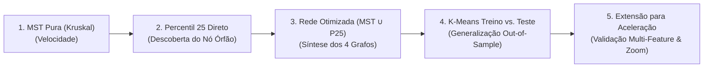

# PAUTA EXECUTIVA: REUNIÃO COM O ORIENTADOR
**Data:** Outubro/2026  
**Estrutura da Apresentação:** Ordem Cronológica de Implementação Prática

---

## 🧭 Roteiro Sequencial da Apresentação

---

### 1. Árvore Geradora Mínima (MST Pura via Kruskal na Velocidade)
> **Motivação:** A matriz de distância DTW completa ($1.700 \times 1.700$) continha $1.444.150$ arestas — uma rede hiper-densa, ruidosa e computacionalmente pesada, na qual a modularidade de Louvain era baixa ($Q = 0{,}1035$). A MST foi a primeira intervenção para extrair o "esqueleto" topológico essencial dos dados.

* **O que abrir na tela:**
  * [Figura 09: Esqueleto da Árvore MST e Histograma de Kruskal](file:///c:/Users/danil/Documents/VSCode/TCC/outputs/figures/09_dtw_mst_pure_tree_train_1700x1700.png)
  * [Figura 10: Heatmap Louvain Reordenado na MST](file:///c:/Users/danil/Documents/VSCode/TCC/outputs/figures/10_dtw_mst_louvain_heatmap_train_1700x1700.png)
  * [Figura 11: Topologia de Rede da MST com Nós Coloridos por Comunidade](file:///c:/Users/danil/Documents/VSCode/TCC/outputs/figures/11_dtw_mst_louvain_topology_train_1700x1700.png)
* **O que falar:**
  * *"Professor, começamos aplicando o Algoritmo de Kruskal sobre a matriz DTW de velocidade ($1.700 \times 1.700$)."*
  * *"Eliminamos 99,88% das conexões ruidosas, retendo apenas as **1.699 arestas essenciais ($N-1$)** que garantem que todas as 1.700 janelas permaneçam interconectadas sem nenhum ciclo."*
  * *"A distância DTW média despencou de **$1.612\text{ km/h}$** na matriz inteira para **$628\text{ km/h}$** na árvore."*
  * *"A Modularidade de Louvain saltou de **$Q = 0{,}1035 \to 0{,}9492$**, revelando 41 micro-comunidades ultracoesas com razão Intra/Inter de **$0{,}382$**."*
  * *"Porém, a árvore pura é esparsa demais e fragmenta comportamentos em 41 micro-grupos, o que nos levou à etapa seguinte."*

---

### 2. Filtro de Percentil 25 Direto ($P_{25}$ na Velocidade)
> **Motivação:** Para obter um grafo com mais densidade e rotas redundantes do que a MST, testamos reter as 25% conexões mais próximas da matriz original ($D_{ij} \le 1.013{,}57\text{ km/h}$).

* **O que abrir na tela:**
  * [Figura 12: Heatmap do Percentil 25 Direto](file:///c:/Users/danil/Documents/VSCode/TCC/outputs/figures/12_dtw_p25_direct_heatmap_train_1700x1700.png)
* **O que falar (O achado empírico / problema encontrado):**
  * *"Em seguida, implementamos o corte rígido de 25% nas menores distâncias DTW ($361.038$ arestas)."*
  * *"Embora a densidade tenha aumentado para 25%, o resultado revelou uma falha conceitual grave do corte cego: o **Nó 1650** (um trecho atípico de alta velocidade na rodovia a $132\text{ km/h}$) teve todas as suas arestas descartadas por ultrapassarem o percentil."*
  * *"O Nó 1650 virou um **nó órfão completamente desconectado**, quebrando a conectividade do grafo (`is_conexo = False`)."*
  * *"Conclusão: um corte estático de percentil não serve sozinho porque isola comportamentos minoritários legítimos."*

---

### 3. A Rede Otimizada ($\text{MST} \cup P_{25}$) e a Síntese dos 4 Grafos
> **Motivação:** Combinar a garantia matemática de conectividade global da MST com a densidade estatística do Percentil 25, criando uma rede robusta, 100% conexa e sem nós isolados.

* **O que abrir na tela:**
  * [Figura 13: Heatmap da Rede Unificada MST ∪ P25](file:///c:/Users/danil/Documents/VSCode/TCC/outputs/figures/13_dtw_p25_mst_heatmap_train_1700x1700.png)
  * [Figura 14: Painel Comparativo dos 4 Cenários Topológicos](file:///c:/Users/danil/Documents/VSCode/TCC/outputs/figures/14_methodology_comparison_synthesis.png)
* **O que falar:**
  * *"Para solucionar o problema dos nós órfãos sem abrir mão da densidade, unimos a MST ao Percentil 25 ($\text{MST} \cup P_{25}$)."*
  * *"Bastou adicionar **1 aresta de resgate** da MST para reintegrar o Nó 1650 com 100% de conectividade ($361.039$ arestas)."*
  * *"O Louvain convergiu em **5 comunidades perfeitamente balanceadas**: três urbanas com tráfego leve/moderado, uma de tráfego denso/para-e-anda e uma de rodovia rápida ($C_4$), onde o Nó 1650 foi integrado com total coerência física."*
  * *"Na síntese dos 4 grafos (Figura 14), provamos formalmente a superioridade da união: a Modularidade triplicou em relação ao grafo bruto (**$0{,}1035 \to 0{,}3185$**), o grafo é 100% conexo e a razão Intra/Inter foi de **$0{,}517$**."*

---

### 4. K-Means Treino (1.700) vs. Teste Out-of-Sample (534)
> **Motivação:** A clusterização topológica via DTW comprova a existência de padrões, mas é cara demais para inferência em tempo real a cada segundo no carro. O K-Means com features estatísticas agregadas é treinado para atuar como o classificador instantâneo ($<1\text{ ms}$). Precisávamos provar sua generalização estrita fora da amostra sem vazamento de dados.

* **O que abrir na tela:**
  * [Figura 15: Projeção PCA 2D Treino (1.700) vs. Teste (534)](file:///c:/Users/danil/Documents/VSCode/TCC/outputs/figures/15_kmeans_train_test_pca_comparison.png)
  * [Figura 16: Perfis de Condução e Validação Física da Potência (kW)](file:///c:/Users/danil/Documents/VSCode/TCC/outputs/figures/16_kmeans_train_test_profiles_comparison.png)
* **O que falar:**
  * *"Em seguida, estruturamos a validação do classificador operacional em tempo real: dividimos rigorosamente a base em **1.700 janelas de treino (76%)** e **534 janelas de teste (24%)**."*
  * *"O `StandardScaler` e o `KMeans(k=3)` foram ajustados **estritamente nos dados de treino**, sem tocar no teste (*zero data leakage*)."*
  * *"Ao aplicar o modelo congelado nas 534 janelas inéditas de teste, o Silhouette Score foi praticamente idêntico: **$0{,}2432$ no treino vs. $0{,}2421$ no teste** ($\Delta = 0{,}0011$). Isso comprova matematicamente que não houve overfitting."*
  * *"A física do veículo elétrico se confirmou em dados inéditos: o perfil Agressivo consumiu média de **$6{,}84\text{ kW}$**, contra **$6{,}69\text{ kW}$** do Econômico, com proporções consistentes entre as bases (Moderado ~61%, Econômico ~23%, Agressivo ~15%)."*

---

### 5. Extensão da Metodologia para Aceleração Longitudinal (`accel_ms2`)
> **Motivação:** Provar que a metodologia DTW + Redes Complexas ($\text{MST} \cup P_{25}$) é uma teoria generalizável para a dinâmica veicular, e não um artifício que só funciona na velocidade.

* **O que abrir na tela:**
  * [Figura 14 (Aceleração): Síntese dos 4 Cenários de Aceleração](file:///c:/Users/danil/Documents/VSCode/TCC/outputs/figures/accel_ms2/14_methodology_comparison_synthesis_accel_ms2.png)
  * [Figura 13 (Aceleração com Zoom Inset): Heatmap MST ∪ P25 com Zoom de C3 e C4](file:///c:/Users/danil/Documents/VSCode/TCC/outputs/figures/accel_ms2/13_dtw_accel_ms2_p25_mst_heatmap_train_1700x1700.png)
* **O que falar:**
  * *"Por fim, parametrizamos nosso pipeline completo para a **Aceleração Longitudinal (`accel_ms2` em $\text{m/s}^2$)** no conjunto de $1.700 \times 1.700$ janelas."*
  * *"Na aceleração, o corte de 25% direto isolou nada menos que **27 nós órfãos** (manobras severas de frenagem com até $-4{,}56\text{ m/s}^2$ e arrancadas com $+3{,}39\text{ m/s}^2$)."*
  * *"A rede unificada $\text{MST} \cup P_{25}$ resgatou exatamente as **27 janelas órfãs** via arestas da MST, restaurando 100% de conectividade."*
  * *"O Louvain encontrou **5 comunidades coesas** com um salto de modularidade de **$0{,}0437 \to 0{,}1803$** (+412%):*
    * *$C_1$ ($32{,}9\%$): condução suave ($0{,}50\text{ m/s}^2$, $0{,}29$ frenagens/min);*
    * *$C_0$ ($46{,}5\%$): condução urbana regular ($0{,}64\text{ m/s}^2$, $0{,}62$ frenagens/min);*
    * *$C_2$ ($20{,}2\%$): condução dinâmica/expressa ($0{,}67\text{ m/s}^2$, $0{,}37$ arrancadas/min);*
    * *$C_3$ (2 janelas) e $C_4$ (3 janelas): micro-comunidades periféricas resgatadas pela MST ($1{,}03\text{ m/s}^2$, $3{,}17$ frenagens bruscas/min), que ilustramos em detalhe no painel de zoom da Figura 13."*

---

## 🛡️ Guia Rápido de Respostas para Perguntas Prováveis do Orientador

| Possível Pergunta do Orientador | Resposta Técnica Direta e Segura |
| :--- | :--- |
| **"O que significa a Razão Intra/Inter e por que ela diminui?"** | *"A distância Intra-cluster mede a dissimilaridade média entre janelas que pertencem à **mesma comunidade**. A Inter-cluster mede a distância entre janelas de **comunidades diferentes**. A razão $\frac{\text{Intra}}{\text{Inter}}$ mede a qualidade da separação: quanto menor que 1, mais parecidos são os membros de um mesmo cluster e mais distantes eles estão dos outros clusters. No grafo bruto era $0{,}597$, e com a MST $\cup$ P25 caiu para $0{,}517$, provando que o filtro purificou os grupos."* |
| **"Por que não usou só o K-Means direto desde o início?"** | *"O K-Means opera sobre médias estáticas agregadas e força esfericidade Euclidiana pré-definindo $k=3$. O DTW com Redes Complexas é não-paramétrico e sensível ao formato temporal das curvas segundo a segundo. Ele serviu como **validação de verdade fundamental (ground truth)**, provando que os padrões de condução existem naturalmente nos dados reais sem imposição do pesquisador."* |
| **"Por que o Percentil 25 gerou nós órfãos?"** | *"Porque janelas com manobras extremas (como rodovia a $132\text{ km/h}$ ou frenagens bruscas a $-4{,}5\text{ m/s}^2$) têm distâncias DTW altas em relação a quase toda a base. Ao aplicar um corte global rígido de 25%, todas as conexões dessas janelas foram cortadas. A união com a MST resolve isso de forma elegante, pois a MST conecta o grafo inteiro com custo global mínimo."* |
| **"Como tudo isso se conecta com a LLM no final?"** | *"A cada 60 segundos de condução, o K-Means e os thresholds calibrados pelo DTW classificam a janela instantaneamente ($<1\text{ ms}$). Essa classificação, junto a variáveis contextuais de telemetria (potência em kW, velocidade, aceleração, tortuosidade de rota por Haversine), é enviada como um JSON estruturado para a LLM. A LLM atua como uma auditora e copiloto especialista, traduzindo números brutos em orientações comportamentais acionáveis para o motorista."* |

---

## 🎯 Pergunta de Fechamento Estratégica
> *"Professor, com a metodologia formal de Ciência das Redes consolidada em velocidade e aceleração, e o classificador K-Means validado em treino/teste com zero data leakage, **podemos avançar para a implementação do módulo de inferência em tempo real integrado à LLM?**"*
