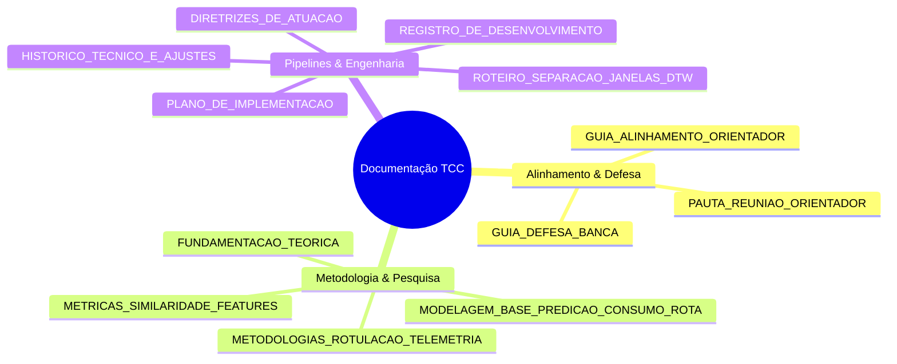

# 📚 CENTRAL DE DOCUMENTAÇÃO E METODOLOGIA DO TCC
## Predição de Consumo Energético e Caracterização de Perfis de Condução em Veículos Elétricos

> **Autor:** Danilo Carvalho de Oliveira  
> **Orientador:** Prof. Me. Douglas Donizeti de Castilho Braz  
> **Instituição:** IFSULDEMINAS – Campus Poços de Caldas  
> **Dataset:** Vehicle Energy Dataset (VED) – Nissan Leaf 2013 (24 kWh)  

---

### 🗺️ Índice Geral de Documentos

Este diretório centraliza todo o conhecimento formal, referencial bibliográfico, decisões arquiteturais e roteiros de defesa desenvolvidos ao longo do projeto.

---

### 1. 🎓 Alinhamento com Orientador & Defesa de Banca

Documentos preparados para reuniões técnicas, alinhamentos metodológicos e arguição da banca examinadora:

* 📄 **[PAUTA_REUNIAO_ORIENTADOR.md](file:///c:/Users/danil/Documents/VSCode/TCC/docs/PAUTA_REUNIAO_ORIENTADOR.md)**  
  *Pauta de reunião estruturada em 6 fases cronológicas, apresentando a evolução do projeto: do janelamento VED ao Louvain na MST e extensão para aceleração e potência.*
* 📄 **[GUIA_ALINHAMENTO_ORIENTADOR_E_RESPOSTAS.md](file:///c:/Users/danil/Documents/VSCode/TCC/docs/GUIA_ALINHAMENTO_ORIENTADOR_E_RESPOSTAS.md)**  
  *Respostas aprofundadas às dúvidas do orientador: por que $\sqrt{N}$ não se aplica a séries temporais contínuas, por que a modularidade da aceleração e potência é menor e explicação do pré-processamento DTW.*
* 📄 **[GUIA_DEFESA_BANCA_E_ARGUMENTACAO.md](file:///c:/Users/danil/Documents/VSCode/TCC/docs/GUIA_DEFESA_BANCA_E_ARGUMENTACAO.md)**  
  *Manual completo de antecipação de perguntas críticas da banca avaliadora, com justificativas matemáticas, físicas e computacionais.*

---

### 2. 🔬 Metodologia Científica, Modelagem & Inteligência Artificial

Especificação conceitual dos modelos de previsão, rotulação e métricas de similaridade:

* 📄 **[MODELAGEM_BASE_PREDICAO_CONSUMO_ROTA.md](file:///c:/Users/danil/Documents/VSCode/TCC/docs/MODELAGEM_BASE_PREDICAO_CONSUMO_ROTA.md)**  
  *Arquitetura em duas camadas (Two-Tier): Baseline nominal da rota via física longitudinal ($E_{\text{nominal}}$) + ajuste dinâmico em tempo real por telemetria ($\alpha(t)$) e integração neuro-simbólica com LLM.*
* 📄 **[METRICAS_SIMILARIDADE_FEATURES_E_MULTIVARIADAS.md](file:///c:/Users/danil/Documents/VSCode/TCC/docs/METRICAS_SIMILARIDADE_FEATURES_E_MULTIVARIADAS.md)**  
  *Pesquisa encomendada pelo orientador sobre métricas de similaridade para séries temporais multivariadas: $DTW_D$ dependente vs $DTW_I$ independente, Distância de Mahalanobis, ARI e NMI.*
* 📄 **[METODOLOGIAS_DE_ROTULACAO_DE_DADOS_TELEMETRIA.md](file:///c:/Users/danil/Documents/VSCode/TCC/docs/METODOLOGIAS_DE_ROTULACAO_DE_DADOS_TELEMETRIA.md)**  
  *Análise dos 4 paradigmas para rotular dados não-supervisionados de telemetria veicular: Física veicular + K-Means, Heurísticas regulatórias (SAE/NHTSA DAI), Propagação em Grafos (Label Spreading) e LLM-as-a-Judge.*
* 📄 **[FUNDAMENTACAO_TEORICA_E_LITERATURA.md](file:///c:/Users/danil/Documents/VSCode/TCC/docs/FUNDAMENTACAO_TEORICA_E_LITERATURA.md)**  
  *Referencial bibliográfico de base: dinâmica veicular do Nissan Leaf, Dynamic Time Warping (DTW), Árvore Geradora Mínima (Kruskal) e Algoritmo de Louvain.*

---

### 3. 🛠️ Pipelines Técnicos, Registro de Desenvolvimento & Rastreabilidade

Roteiros de execução, divisão de dados e histórico de decisões de engenharia:

* 📄 **[ROTEIRO_SEPARACAO_JANELAS_DTW_E_TREINO_TESTE.md](file:///c:/Users/danil/Documents/VSCode/TCC/docs/ROTEIRO_SEPARACAO_JANELAS_DTW_E_TREINO_TESTE.md)**  
  *Protocolo de janelamento (120s/60s), split estratificado com 1.700 trechos de treino e 534 de teste (zero vazamento de dados) e geração das matrizes DTW.*
* 📄 **[HISTORICO_TECNICO_E_AJUSTES.md](file:///c:/Users/danil/Documents/VSCode/TCC/docs/HISTORICO_TECNICO_E_AJUSTES.md)**  
  *Log de evolução técnica, ajustes de unidades dinâmicas (`km/h`, `m/s²`, `kW`) e validação da transição para pipelines multi-feature.*
* 📄 **[PLANO_DE_IMPLEMENTACAO.md](file:///c:/Users/danil/Documents/VSCode/TCC/docs/PLANO_DE_IMPLEMENTACAO.md)**  
  *Requisitos funcionais, dependências e plano de ação estruturado de cada fase do código.*
* 📄 **[REGISTRO_DE_DESENVOLVIMENTO.md](file:///c:/Users/danil/Documents/VSCode/TCC/docs/REGISTRO_DE_DESENVOLVIMENTO.md)**  
  *Diário de bordo detalhado de cada commit, experimento e consolidação de resultados.*
* 📄 **[DIRETRIZES_DE_ATUACAO_E_PROMPT_ASSISTENTE.md](file:///c:/Users/danil/Documents/VSCode/TCC/docs/DIRETRIZES_DE_ATUACAO_E_PROMPT_ASSISTENTE.md)**  
  *Prompt mestre e diretrizes acadêmicas de atuação do assistente para preservação do rigor científico do TCC.*
